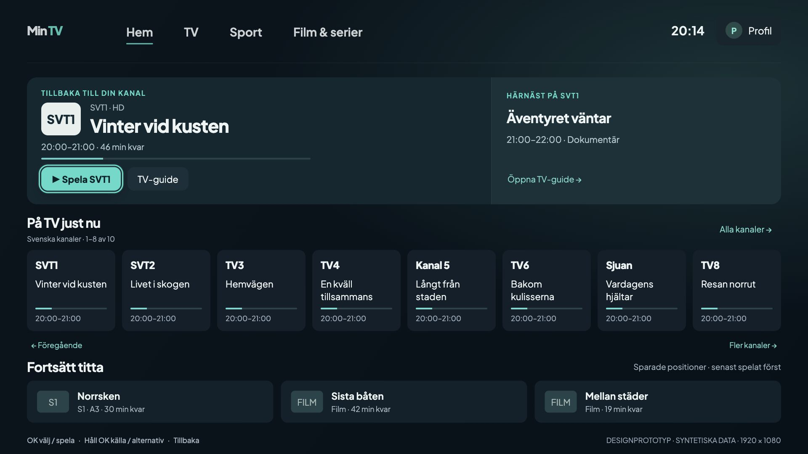
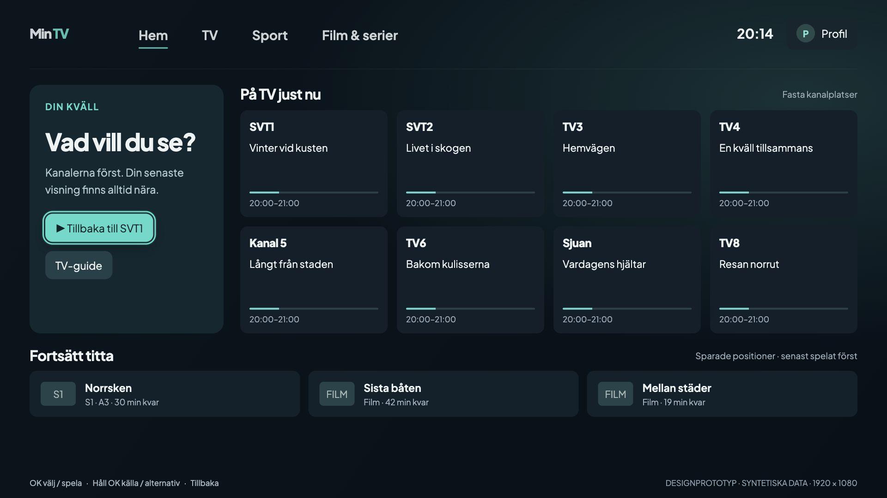
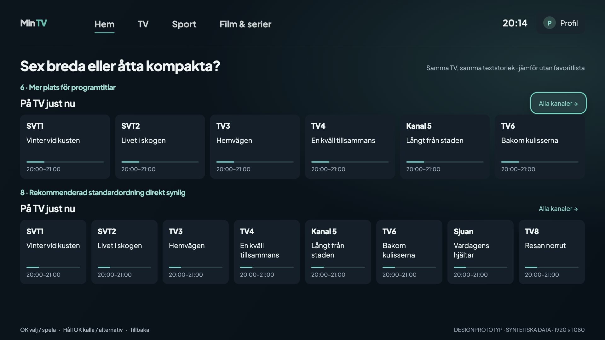
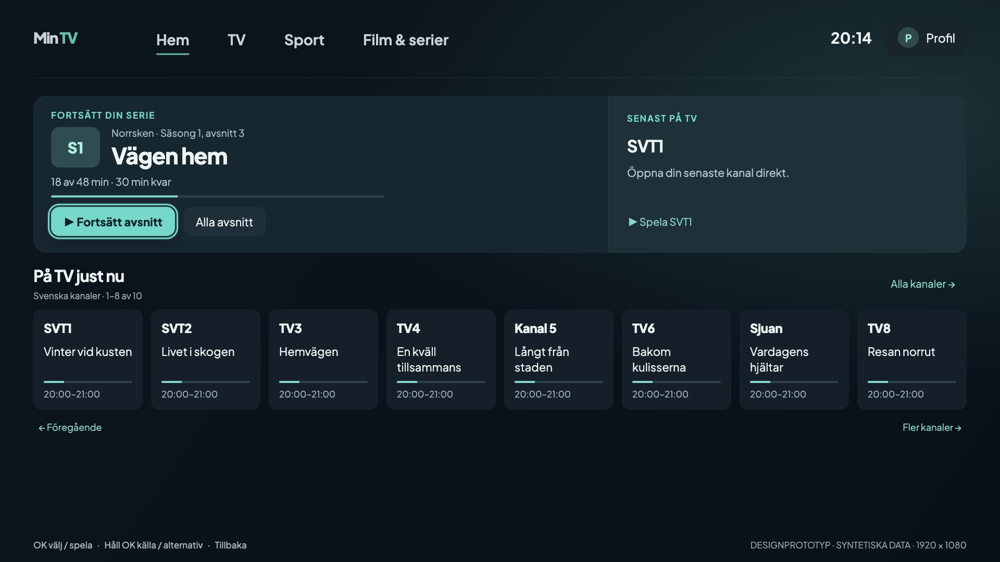
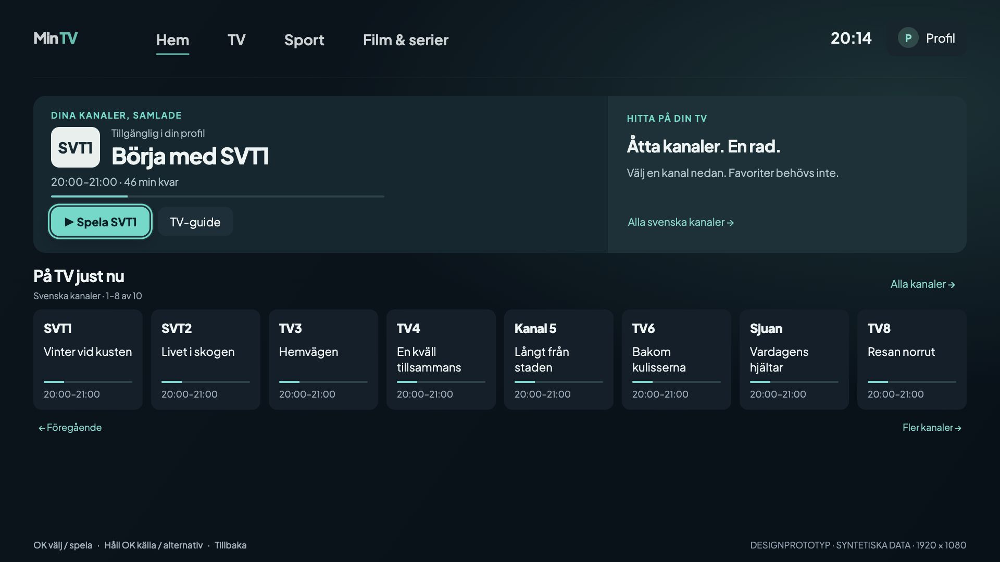
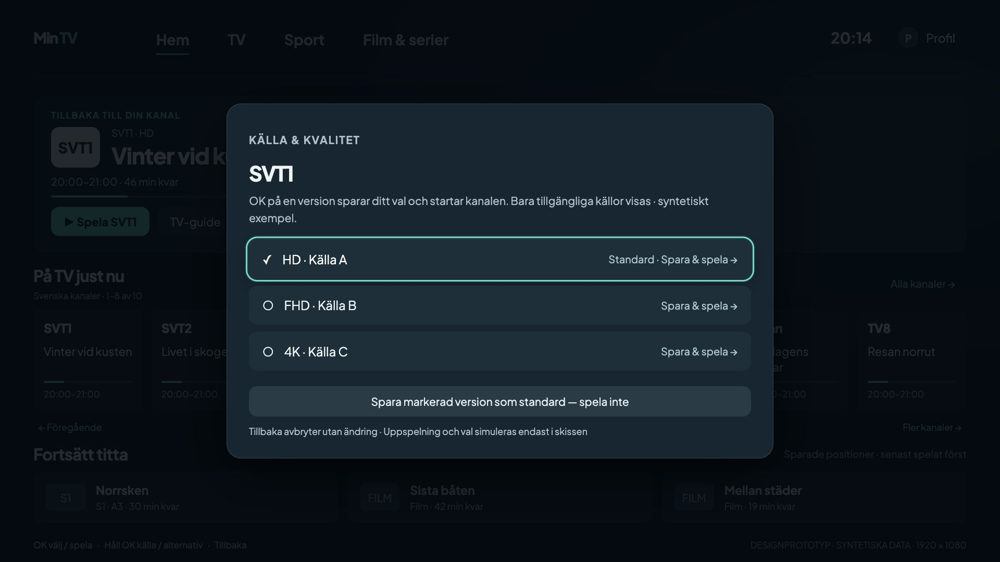
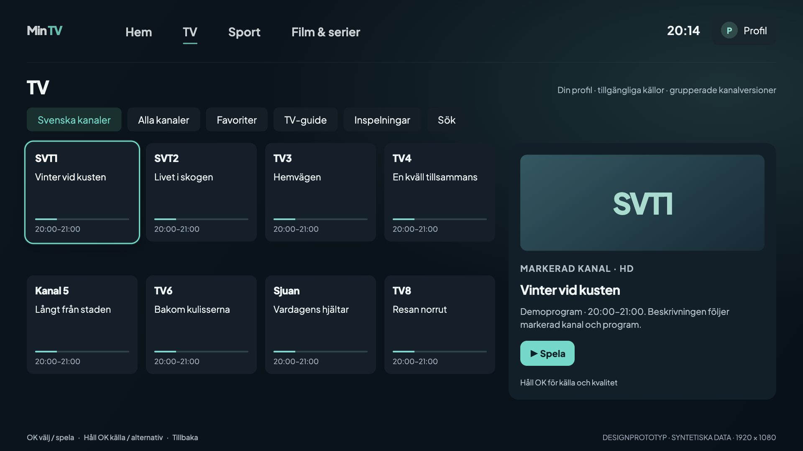
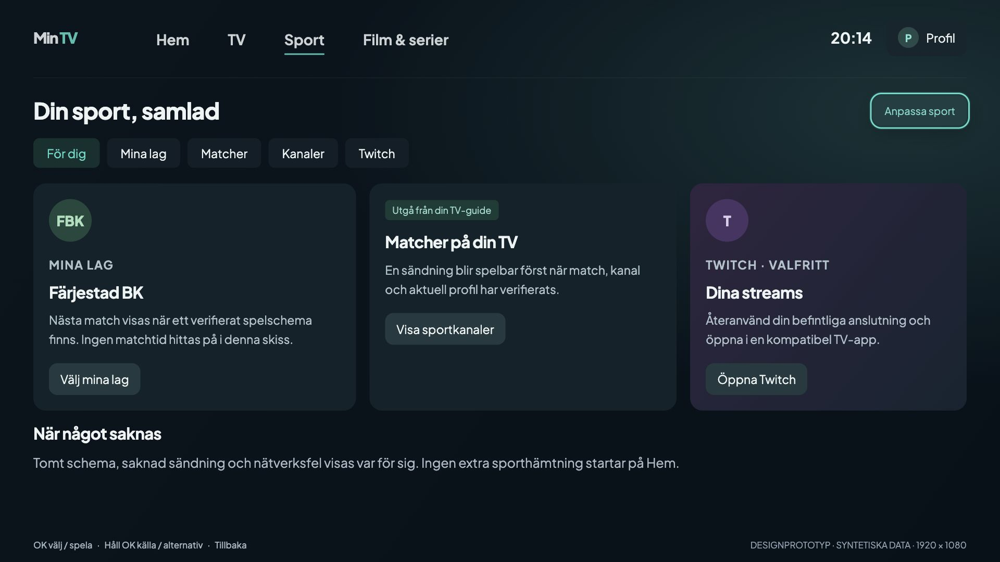
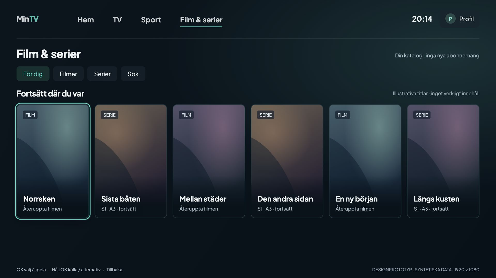
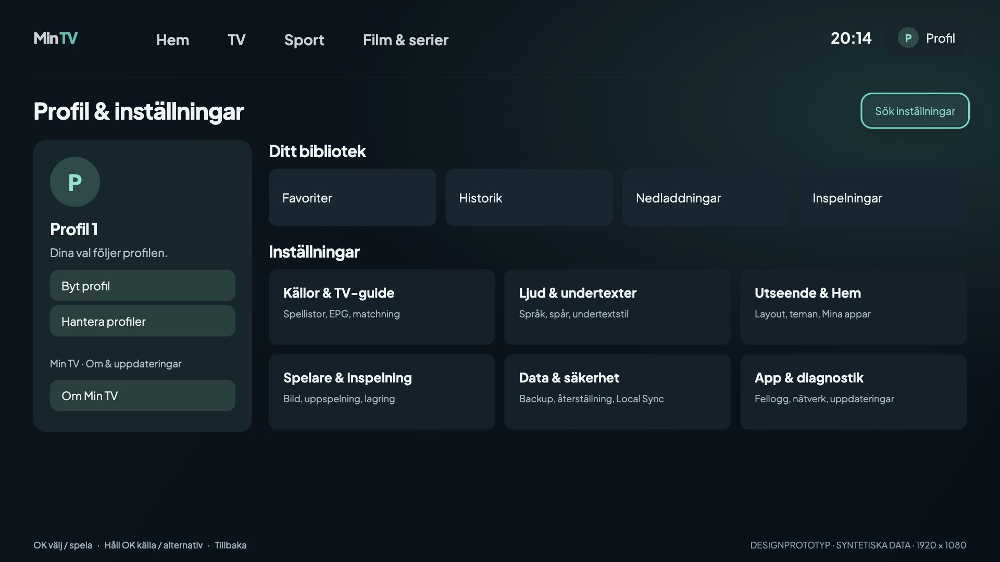

# Min TV v0.10 — navigation and Smart Home proposal

**Design review only.** No production Kotlin, resources, database, dependencies, signing or release
workflow is changed. No Android package was installed, removed, opened or cleared for this work.

Reviewed application: `main` **7c4411d5280b439b7fb7916eade3d80dc2baf2ff**, including merged v0.9.1
reliability work. The owner-accepted physical production baseline remains **Stable v0.9.0 / 1000011**.
Those are different baselines: this proposal does not claim v0.9.1 was installed or accepted physically.
Pinned Core: `adca2bcd653f19e6e5d659c2722309e6aef4ec15`.

## Review the deliverables

- [Architecture, focus behavior and implementation phases](architecture.md)
- [Complete destination migration map](destination-map.md)
- [Channel/source and subtitle assessment](playback-and-preferences.md)
- [Validation and remaining decisions](validation.md)
- [Interactive offline preview](prototype/index.html): open locally in a browser; GitHub renders its
  source rather than running it. The prototype is a design tool, **not a WebView to ship in the app**.

The preview supports arrows, short Enter, held Enter (500 ms), Escape/Back, top navigation,
remembered content focus and a source picker. Use the review controls above the TV canvas to compare
Home alternatives and empty/offline/missing-EPG states. Everything is synthetic. It never reads a
playlist, plays video, signs in, fetches sport/EPG or changes installed-app data.

## Final iteration — recommended for review

Choose **Din kväll**, the refined Lugn start. A compact current/next programme composition replaces
empty decorative artwork. Eight logical Swedish channels and three genuine resume items fit on one
1080p screen. An active episode can lead when its actual history merits it; empty sections disappear.

**[Read the final rules, comparison, remote contract and open decisions](iteration-2.md).**
This iteration supersedes conflicting Home, library and picker behavior in the initial proposal.
Implementation still requires owner approval; the first native milestone remains the shell adapter.

### A different direction: Kanalbordet

### Six versus eight, at identical scale

### Smart Home states

| Active series | No viewing history |
| --- | --- |
|  |  |

[Missing EPG](mockups/home-cinema-no-epg.jpg) · [No progress](mockups/home-cinema-no-progress.jpg) ·
[Six-card Home](mockups/home-cinema-six-cards.jpg) ·
[Previous Lugn start](mockups/previous/home-cinema.jpg) · [Previous alternative](mockups/previous/home-split.jpg)

### Save and play, with a separate save-only action

## Destination previews

| TV | Sport |
| --- | --- |
|  |  |

| Film & serier | Profil & inställningar |
| --- | --- |
|  |  |

[Source picker](mockups/quality-picker.jpg) · [Guide](mockups/tv-guide.jpg) ·
[No history](mockups/home-cinema-no-history.jpg) · [No EPG](mockups/tv-no-epg.jpg) ·
[Empty TV profile](mockups/tv-empty.jpg) · [Offline Sport](mockups/sport-offline.jpg)

All previews are **1920×1080**. Channel wordmarks are schematic text, not new logo assets.
Programme names, sources and VOD placeholders are synthetic examples, not a claim about the owner's
actual lineup or content. Sport intentionally shows honest schedule/availability states rather
than inventing a match. Production logos/artwork must come from authorized existing provider/cache
sources, with readable text fallback. No private device screenshot, IPTV data or original app APK
is included in the PR.
